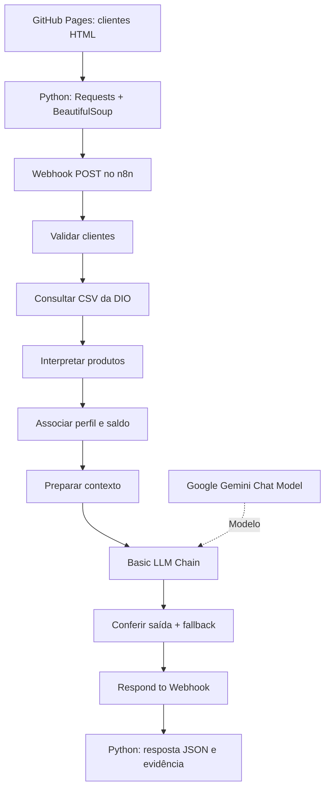

Assistente de Investimentos com RPA, n8n e Gemini
Laboratório educacional da DIO | Protótipo com dados fictícios | Teste ponta a ponta documentado

Implementação realizada a partir do material-base da Digital Innovation One (DIO). O projeto simula a comunicação sobre opções de investimento; não opera investimentos, não consulta contas reais e não constitui recomendação financeira.

1. Objetivo
Construir um fluxo que extraia registros fictícios de clientes de uma página HTML com Python, processe os dados no n8n, consulte um CSV de produtos didáticos, relacione perfil e saldo mínimo e produza mensagens personalizadas com apoio do Google Gemini. A saída retorna ao script Python em formato JSON.

A seleção de produtos é feita por regras determinísticas e auditáveis; a LLM escreve somente uma introdução curta. Essa separação limita o risco de produtos, taxas ou critérios inventados na mensagem.
2. Arquitetura

Componentes
Tecnologia	Finalidade
Python, Requests e BeautifulSoup	Extração automatizada da tabela HTML e envio HTTP dos clientes
GitHub Pages	Hospedagem das bases públicas fictícias usadas pela DIO
n8n Cloud	Orquestração, validação, tratamento de dados e resposta HTTP
JavaScript (Code nodes)	Normalização, leitura do CSV, filtro de perfil e aporte mínimo
Google Gemini 3.5 Flash-Lite	Geração de uma introdução textual personalizada
JSON	Intercâmbio Python ↔ n8n e registro dos resultados

O arquivo exportado foi revisado para publicação em n8n/workflow.json, sem chave de API, referência interna de credencial ou identificadores da instância. Ao importá-lo em outro n8n, é preciso selecionar uma credencial própria no nó Gemini.
3. Como a automação funciona
1. O Python extrai nome, email, saldo e perfil da tabela pública de clientes simulados.
2. O Webhook recebe de 1 a 10 clientes em um JSON com o campo clientes.
3. Um nó Code valida campos, e-mails, perfis, saldos e duplicidade de e-mail no lote.
4. O n8n consulta a base didática data.csv da DIO.
5. Para cada cliente, filtra produtos de perfil correspondente cujo minimo não ultrapasse o saldo fictício.
6. O nó Basic LLM Chain, conectado ao Google Gemini Chat Model, solicita somente uma saudação/introdução.
7. Outro nó Code valida superficialmente o texto gerado e monta a mensagem definitiva, usando a lista de produtos calculada por regras. Se a IA falhar, utiliza texto estático (fallback).
8. O nó Respond to Webhook devolve os resultados em JSON ao Python, que salva a evidência local.
Limite técnico: foi utilizado Basic LLM Chain + Chat Model, e não o nó específico AI Agent com ferramentas e memória. A integração de LLM foi demonstrada, mas não se deve descrever o projeto como agente autônomo.
4. Execução do laboratório
Pré-requisitos
- Python 3.10+ e acesso à internet;
- Instância n8n (Cloud ou local) com workflow importado;
- Credencial própria do Google Gemini configurada no n8n;
- Fonte de dados fictícios da DIO acessível.
Instalação
No PowerShell, a partir da raiz deste repositório:
python -m pip install -r requirements.txt
Para apenas conferir a extração, sem chamar o n8n:
python .\rpa\extrair_e_testar.py --limite 2 --somente-extrair
Executar o n8n em modo de teste
1. Importe n8n/workflow.json no editor do n8n.
2. Abra Google Gemini Chat Model, selecione sua credencial e confirme o modelo disponível.
3. Salve o workflow e clique em Execute workflow ou Listen for test event no nó Webhook.
4. Copie a Test URL do nó Receber clientes e defina a variável de ambiente:
$env:N8N_WEBHOOK_URL = "https://SEU-N8N/webhook-test/clientes-investimentos-v2"
python .\rpa\extrair_e_testar.py --limite 2
O endpoint de teste só fica registrado quando o n8n está aguardando o evento e geralmente é consumido após uma chamada. Para repetir, reative a escuta. Não exponha o Webhook de demonstração sem autenticação à internet como serviço público.

Para repetir o teste documentado com sete clientes fictícios, após reativar a escuta:
python .\rpa\extrair_e_testar.py --limite 7
O script salva um JSON na pasta evidencias/ por padrão. Neste fork, as evidências selecionadas foram publicadas na pasta evidence/. O caminho de gravação local e a pasta publicada não precisam ser idênticos.
5. Validação e resultados observados
Os números abaixo se referem à execução apresentada pelo autor com sete clientes fictícios, e não a um teste de produção nem à base completa de dez clientes.
Métrica	Resultado observado
Clientes encontrados na página HTML	10
Clientes selecionados no teste	7
Resposta da integração HTTP	200
Mensagens retornadas pelo n8n	7
Mensagens com modo_mensagem = gemini_com_dados_deterministicos	7
Associações cliente × produto elegível	19
Fallback estático no teste de 7 clientes	0 indicado

Resumo dos sete registros
Cliente fictício	Perfil	Saldo fictício (R$)	Produtos filtrados
Ana Silva	Conservador	12.500	3
Bruno Lima	Moderado	3.200	2
Carla Souza	Arrojado	28.900	3
Daniel Oliveira	Conservador	850	2
Elena Rodrigues	Arrojado	45.000	3
Felipe Santos	Moderado	7.800	3
Gabriela Costa	Conservador	1.500	3
Total			19

A saída inclui opcoes_elegiveis, quantidade_opcoes, mensagem, texto_ia, modo_mensagem e fonte_produtos. O texto da IA foi aceito na validação básica definida no workflow; isso não equivale a uma auditoria semântica ou financeira independente.
Evidências da execução
- [Captura do workflow](evidence/nodes_ok.png)
- [Captura do PowerShell](evidence/powershell_check.png)
- [JSON real: 2 clientes](evidence/resultado-python-2-clientes.json)
- [JSON real: 7 clientes](evidence/resultado-python-7-clientes.json)
Os arquivos de evidência acima já se encontram no fork. Não foram fabricados registros ou prints para esta documentação.
6. Decisões técnicas e segurança
- Fonte controlada: o conjunto de produtos é lido da base CSV fictícia da DIO, não inventado pelo Gemini.
- Filtragem determinística: o filtro exige perfil correspondente e aporte mínimo menor ou igual ao saldo fictício.
- Geração restrita: a IA escreve apenas a introdução; nomes de produtos e valores da listagem são montados em JavaScript.
- Resiliência: uma resposta vazia, inválida ou uma falha da API pode acionar fallback_estatico.
- Sem dados reais: não utilizar cadastros, e-mails ou saldos reais nesse laboratório.
- Sem envio de e-mail: o fluxo demonstrado não envia mensagens pelo Gmail.
- Sem operações financeiras: não há ordens de compra, contratação de produtos ou transações.
- Credenciais fora do GitHub: não publicar chaves de API, tokens ou segredos de autenticação.
7. Limitações e próximos passos
A validação principal abrange sete clientes fictícios enviados em uma única requisição. O fluxo não foi homologado para produção, não possui controle de autenticação de usuários nem valida conformidade financeira. A validação de texto da IA é básica, não substitui revisão humana. A API Gemini pode apresentar erros de cota, indisponibilidade ou demora de resposta; execuções longas podem atingir o tempo-limite do Webhook.

Possíveis evoluções: testes de entradas inválidas, validação automatizada das saídas, tratamento assíncrono de lotes, métricas de latência e revisão humana antes de qualquer comunicação externa.
8. Créditos e origem
Projeto educacional desenvolvido no contexto do desafio Criando um Assistente de Investimentos com RPA e IA Generativa, da Digital Innovation One (DIO). A base de clientes, o CSV e o notebook de extração iniciais vêm do repositório oficial do laboratório. A implementação do workflow e os testes complementam o material didático original.
